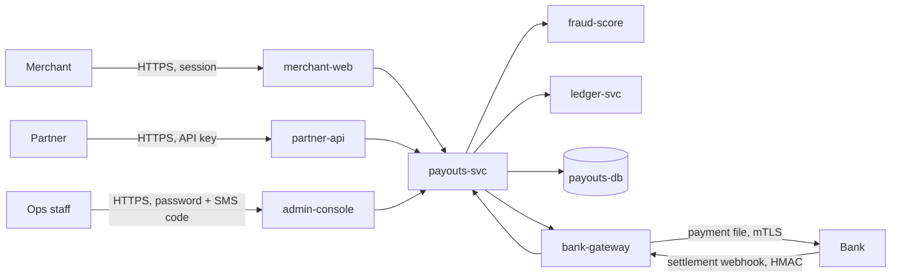

# Payouts — architecture

Revision 14 · 2026-09-30 · owner: payments-platform

## Components

| Component | What it does | Runs as |
|---|---|---|
| `merchant-web` | Merchant dashboard: balance, payout history, bank details | public web app |
| `partner-api` | Payout requests from payment facilitators (added 2026-02) | public API, API keys |
| `admin-console` | Ops staff: review and approve large payouts, manage payees, support tools | internal web app |
| `payouts-svc` | Owns payout state machine: requested → approved → sent → settled | internal service |
| `ledger-svc` | Merchant balances, double-entry | internal service |
| `fraud-score` | Scores each payout request (0–100) | internal service |
| `bank-gateway` | Sends payment files to the bank; receives settlement webhooks | internal service, egress to bank |
| `payouts-db` | Postgres: payouts, payees, approvals | managed database |

## Data flow

## Trust and network

All internal services run in one VPC. **Internal services are trusted: traffic between services
behind the VPC needs no authentication**, which keeps latency low and avoids managing service
credentials. Only `merchant-web`, `partner-api` and `admin-console` are reachable from outside, through
the load balancer. TLS terminates at the load balancer for public traffic; service-to-service calls
inside the VPC also use TLS.

## Payout flow

1. A payout is requested by a merchant (`merchant-web`) or by a partner on a merchant's behalf
   (`partner-api`).
2. `payouts-svc` asks `fraud-score` for a score. Scores above 70 are held for review.
   **If `fraud-score` is unavailable or times out (800 ms), the payout proceeds without a score so that
   merchants are not blocked**; the event is logged at WARN.
3. Payouts under 5,000 USD are approved automatically. Payouts of 5,000 USD or more need one approval in
   `admin-console` — see ADR-0003.
4. `bank-gateway` sends the payment file. Once sent, a payout cannot be recalled.
5. The bank posts a settlement webhook; `payouts-svc` marks the payout settled.

## Payees

A payee is the bank account a merchant is paid to. Merchants add payees in `merchant-web` (with e-mail
confirmation). Ops managers can also create or change a payee from `admin-console` when a merchant
calls support.
