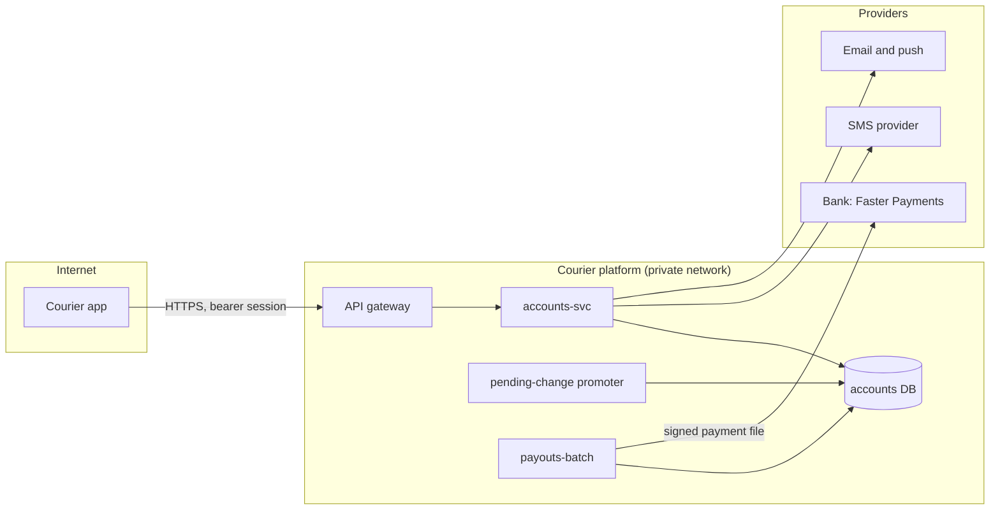

# Design: couriers change their payout account in the app

| | |
|---|---|
| Status | Approved by Courier Payments. Security review requested before launch |
| Version | 1.3, 2026-11-14 |
| Launch | 2026-12-01, all markets |
| Owner | Courier Payments (accounts-svc team) |

## Why

A courier who changes bank today emails support, and an agent types the new details in. That is
about 4,100 tickets a month and the most common reason a courier misses a payout. This design lets
couriers change the account themselves in the app, with controls strong enough that a stolen
password alone can't redirect anyone's earnings.

## Scope

**In scope:** the courier app flow, the accounts-svc public API, the pending-change promoter, and the
notifications.

**Out of scope:** the Ops Console and support tooling. They are a separate system owned by Courier
Operations, and support agents are trusted staff, vetted at hire; insider risk is covered by HR
policy.

## Assets

| Asset | Why it matters |
|---|---|
| Courier payout account (account number, sort code, holder name) | Where about 38,000 couriers' weekly earnings go: median £310 a week, top decile over £900 |
| Courier credentials and the registered phone | They authorise the change |

## Data flow

## The flow

1. The courier signs in with email and password. Sessions last 30 days on a registered device.
2. Settings → Payout account → Change. The app collects the new account number, sort code and holder name.
3. **Step-up.** accounts-svc sends a 6-digit code by SMS to the registered phone. Five attempts, then a
   one-hour lock; a code is valid for five minutes.
4. `POST /v1/me/payout-account-changes` with the step-up token creates a `PendingPayoutChange`
   (status `pending`, `effective_at` = now + 72 hours).
5. **Notice.** accounts-svc emails the registered address and pushes to the courier's devices: "Your
   payout account changes on <date>. Not you? Cancel." The cancel link is signed and single use.
6. The **pending-change promoter** runs every 15 minutes and copies a pending account into
   `couriers.payout_account` once `effective_at` has passed and the change was not cancelled.
7. **payouts-batch** pays every courier to `couriers.payout_account` on Friday at 06:00 (see `docs/payouts.md`).

## Controls

| Threat | Control |
|---|---|
| Account takeover by credential stuffing | Rate limit on `/login`; breached-password check at sign-up and password change |
| Attacker changes the payout account | SMS step-up, then the 72-hour hold with a notice and a cancel link |
| Step-up code brute force | Five attempts, then a one-hour lock |
| Account numbers in the database | Column encrypted under a KMS envelope key that only accounts-svc can use |
| Payment file tampering | payouts-batch signs the file with the bank-issued key, held in an HSM |

## Open risks

- **SIM swap.** Security flagged SIM swap as the main risk: someone who ports a courier's number gets the
  step-up code. We think the 72-hour hold and the email notice cover it, but want a view.
- Push notifications can be turned off; the email is the backstop.

## Later

- Passkeys for step-up (2027 Q2).
