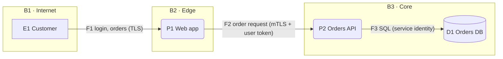

# Design Patterns — Notation, Templates and Catalogues

> What Design mode builds with. §1–§5 are the modelling notations and templates in the order the
> method uses them; §6–§8 are the catalogues a design chooses from; §9–§11 are the outputs. Cite the
> principle (S-N, [`theory.md`](theory.md)) when you choose; say why when you deviate from the
> default.
>
> Everything is written with placeholders — `<system>`, `<asset>`, `<zone>`, `<role>` — so the model
> fits any organisation. Keep organisation names, product names and internal tool names out of the
> reusable parts; they belong only in the instance.

---

## §1 Data-flow diagram and trust boundaries

Five element types, each with an ID the rest of the model references:

| Element | ID | Draw as | Means |
|---|---|---|---|
| External entity | `E1…` | rectangle | A person or system outside your control: customer, partner, admin's laptop, third-party API |
| Process | `P1…` | rounded box / circle | Code you run: a service, a function, a job, a CI pipeline |
| Data store | `D1…` | open-ended box / cylinder | Where data rests: database, bucket, queue, cache, log store, key vault |
| Data flow | `F1…` | arrow, labelled with what moves | Data in motion between two elements |
| Trust boundary | `B1…` | dashed line or zone, named | Where the level of trust changes — different principal, privilege, network, tenant, organisation or physical control |

**Rules.**

- **People are entities.** Admins, support agents, customers and partners appear on the diagram,
  and so do the onboarding and recovery flows they use (S2, S7).
- **A boundary exists wherever trust changes**, not only where the network does: user ↔ service,
  service ↔ service with different identities, tenant ↔ tenant, app ↔ database, CI ↔ production,
  you ↔ a vendor.
- **Every flow that crosses a boundary gets a row** in the boundary-crossing table:

| Flow | From → To | Crosses | Authentication | Authorisation decision (where) | Channel | Validation |
|---|---|---|---|---|---|---|
| F3 | E1 customer → P1 web | B1 internet / edge | OIDC session | per route, in P1 | TLS 1.3 | schema + size limits |
| F7 | E4 partner → P2 orders-api | B3 partner / core | mTLS client cert | per tenant, in P2 | mTLS | signed payload |

  A blank cell is a gap to explain or a finding.
- **Mark the trusted computing base**: the elements whose failure breaks the policy (S4).
- **Label reconstructed diagrams** as reconstructed, with the code/IaC paths they came from.

Mermaid skeleton:



---

## §2 STRIDE per element and per crossing

STRIDE (Practice; named in SE §27.3.5, p.1006) is a checklist of six threat types against the
property each violates. Apply it **per boundary crossing** first — that's where attacks enter —
then per element.

| Threat | Property violated | Applies to | Typical mechanisms |
|---|---|---|---|
| **S**poofing | Authentication | Entities, processes, flows | Strong authn, mutual TLS, signed requests, fresh challenge (S17) |
| **T**ampering | Integrity | Processes, stores, flows | MACs/signatures, AEAD, write-only from higher integrity, Clark-Wilson procedures (S13, S21) |
| **R**epudiation | Non-repudiation / accountability | Entities, processes | Attributable identities, audit outside admins' reach, signed approvals (S23) |
| **I**nformation disclosure | Confidentiality | Processes, stores, flows | Authorisation at the data, encryption, minimisation, metadata protection (S11, S16) |
| **D**enial of service | Availability | Processes, stores, flows | No work before authn, rate limits, quotas, replicas, safe degraded modes (S22) |
| **E**levation of privilege | Authorisation | Processes | Least privilege, no confused deputy, complete mediation (S4, S12) |

| Element type | S | T | R | I | D | E |
|---|:-:|:-:|:-:|:-:|:-:|:-:|
| External entity | ✓ | | ✓ | | | |
| Process | ✓ | ✓ | ✓ | ✓ | ✓ | ✓ |
| Data store | | ✓ | (logs) | ✓ | ✓ | |
| Data flow | | ✓ | | ✓ | ✓ | |

Record each threat as `T-<n>` with: element/crossing, STRIDE letter, the adversary (§6) who can
mount it, the asset at stake, existing mechanisms, residual risk.

---

## §3 Threat tree (top-down)

Root = an undesired outcome the owners can't tolerate; children = immediate causes; recurse until
each leaf is a concrete attack step an adversary in §6 can perform (SE §27.3.3, pp.1003–1004).
Countermeasures hang off the branches they cut.

```text
H1  Attacker moves money out of a customer account
├── 1  Takes over the customer's session
│   ├── 1.1  Credential stuffing on login            [Crook/Charlie · scales]   ⟂ M1 rate limit, M2 breached-pw check, M3 MFA
│   ├── 1.2  Phishes OTP and relays it live          [Crook/Charlie]            ⟂ M4 transaction-bound approval
│   └── 1.3  Resets password via support             [Crook/Derek · insider-assisted] ⟂ M5 recovery needs factor, M6 out-of-band notice
├── 2  Changes the payee after approval              [Insider]                  ⟂ M7 approval binds payee; M8 edit invalidates approval
└── 3  Replays a captured transfer request           [Crook/Bruno]              ⟂ M9 nonce + signature
```

**Look for shared branches** — a cause under several roots is where one mechanism disrupts many
attacks. Keep the tree a living document; re-run it when a trust boundary changes (S24).

---

## §4 FMEA (bottom-up, high-assurance tier)

For each component, what happens to the mission when it fails — by accident **and** under a
malicious actor at that location (SE §27.3.3–§27.3.5, pp.1004–1006).

| Component | Failure mode | Accidental cause | Malicious cause | Effect on mission | Detection | Fail open/closed | Mechanisms |
|---|---|---|---|---|---|---|---|
| P3 authz service | Unavailable | Deploy error, overload | DoS | Orders rejected (closed) — or accepted unchecked (open) | Health probe, error rate | **Closed** | M10 cache with short TTL, M11 alert |
| D2 audit log | Records lost or altered | Disk full | Admin edits | Disputes unresolvable | Hash-chain verify | n/a | M12 separate account, append-only |

---

## §5 Hazard × mechanism matrix

Rows: serious hazards (the roots of §3). Columns: mechanisms. Every serious hazard needs **two
independent mechanisms** — independent meaning one failure, insider or compromise doesn't defeat
both (SE §27.3.5, p.1006; S22).

| Hazard | M1 | M3 | M4 | M7 | M9 | M12 | Count | Independent? |
|---|:-:|:-:|:-:|:-:|:-:|:-:|:-:|---|
| H1 Money moved out | ✓ | ✓ | ✓ | ✓ | ✓ | | 5 | Yes — authn, approval and integrity are separate systems |
| H2 Bulk export of customer data | | ✓ | | | | ✓ | 2 | **No** — both rely on the admin IdP; add a data-layer control |
| H3 Signing key stolen | | | | | | | 0 | **Gap** |

A row with one mechanism, or two that share a dependency, is a finding (TM-RES).

---

## §6 Adversary catalogue

**Opponent classes** (SE ch.2, pp.66–67) — name the ones that apply and what they want here:

| Class | Typical motive | Typical capability | Notes |
|---|---|---|---|
| **Spies** — state and corporate intelligence | Long-term access, bulk data, coercion | High: zero-days, supply chain, insiders, legal compulsion | Tools migrate down to crooks over time |
| **Crooks** — organised crime, fraudsters | Money: fraud, ransom, resale | Industrialised: botnets, credential stuffing, phishing kits, mule networks, ransomware-as-a-service | Defend against what scales first (S6) |
| **Researchers** — academics, bug hunters, journalists | Credit, bounties, publication | Skilled, patient, public | An ally with a disclosure route; an adversary without one (S24) |
| **Abusers** — stalkers, controlling partners, trolls, disgruntled insiders | Control, harassment, revenge | Physical access, shared devices, knowledge of the victim, legitimate accounts | Model abusability (S7) |
| **Insiders** — staff, contractors, support, ops | Money, grievance, coercion | Legitimate access, knowledge of controls | Name the must-trust roles (S7) |

**Grades** (SE §13.2.1, pp.513–514) — the attacker each control is sized for:

| Grade | Archetype | Resources | Design implication |
|---|---|---|---|
| 1 | **Derek** — the opportunist | Public tools, low skill, little time | Defaults, patching, no exposed admin, no default credentials |
| 2 | **Charlie** — the experienced criminal | Kits, rented infrastructure, persistence | MFA, rate limits, transaction binding, monitoring that's read |
| 3 | **Bruno** — the professional | Custom tooling, insider recruitment, weeks of effort | Defence in depth, dual control, key custody, hostile testing |
| 4 | **Abdurrahman** — the state team | Zero-days, supply chain, physical access, legal compulsion | Hardware roots of trust, minimal TCB, assume breach, independent audit |

Low grades can rent high-grade capability (SE §18.4, pp.644–645): a grade-2 crook can buy a botnet
or a zero-day. Size scaling attacks to the tool, not the buyer.

For each adversary record: class, grade, motive, **legitimate access** it can obtain, attack paths
(tree branches), and which attacks it can scale.

---

## §7 Access-control model chooser

Choose by what must hold (S13); combine where needed, and say which layer enforces each (S11).

| What must hold | Model | Use when | Watch for |
|---|---|---|---|
| People get permissions by job | **RBAC** (groups for people, roles for functions) | Most business apps | Role explosion; one role spanning contexts — add relationship checks (SE §10.4.4) |
| Access depends on attributes of subject, object, context | **ABAC** / policy engine | Tenancy, data class, time, location, ownership | Policies nobody can read; test them like code |
| Easy delegation of a specific right | **Capabilities** (tokens, signed URLs, file descriptors) | Sharing links, delegated API access, OAuth | Revocation is hard; keep lifetimes short (S20) |
| Confidential data must not flow down | **Bell-LaPadula** (no read up, no write down) | Classified/compartmented data, multi-level exports | Label creep; trusted-subject exceptions (SE §9.3.3) |
| Low-integrity code must not corrupt high-integrity state | **Biba** (no write up) | Monitoring → control systems, CI → prod, browser sandboxes | Paths that read low and write high |
| Each process confined to its own domain | **Type enforcement** / MAC (SELinux-style) | Multi-service hosts, confinement after compromise | Policies left permissive |
| Money and records change only by well-formed transactions | **Clark-Wilson** (certified procedures, integrity checks, append-only audit, separation of duty) | Ledgers, payments, entitlements, inventory | Admin SQL and "manual adjustments" (S13) |
| Seeing A forbids seeing competitor B | **Chinese Wall** | Consultancies, marketplaces, multi-client support | Cooling-off periods too short |
| Per-record consent and attribution | **Multilateral / BMA-style** (per-record ACL, responsible owner, notification, aggregation control) | Health, HR, legal | Aggregation by long-tenured staff (SE §10.2, §10.4.2) |

Then add the procedural layer (S14): which operations need **dual control** (two act together),
which need **functional separation** (complementary roles), which need **several independent
conditions**, and how **break-glass** is logged, alerted and reviewed.

---

## §8 Protocol pattern catalogue

| Need | Pattern | Avoid | S |
|---|---|---|---|
| Prove a device or client is live | **Challenge-response** with a fresh nonce; or signed requests with timestamp + nonce and a replay window | Static API keys, serial numbers, fixed codes | S17 |
| Approve a high-value action | **Transaction signing**: show payee/amount/action on a trusted display, sign that content, verify server-side | OTP that approves "a transaction"; SMS as the independent channel | S18 |
| Service-to-service identity | **mTLS** with short-lived workload certificates, or signed short-lived tokens (audience-bound) | Shared secrets across services; network location as identity | S9, S20 |
| User sessions and API access | **Short-lived access tokens** + rotating, revocable refresh tokens; OIDC ID token for identity, OAuth for delegation | Long-lived bearer tokens; access tokens as identity; `alg: none` | S20 |
| Many devices, one secret | **Key diversification**: per-device keys derived one-way from a master held in an HSM | One fleet-wide key; keys derived from serials | S19 |
| Crown-jewel key | **Threshold / secret sharing** with usable ceremony; HSM custody; dual control on use | One person holding the key; key halves stored together | S19, S14 |
| Data confidentiality + integrity | **AEAD** (AES-GCM, ChaCha20-Poly1305) with unique nonces, keys from a KMS | ECB; CBC without MAC; nonce reuse | S21 |
| Revoke quickly | **Short lifetimes** first; then introspection or push-revocation for what must outlive minutes | Long-lived certificates with CRLs nobody checks | S20 |
| Trustworthy time | Authenticated time sources, bounded skew, monotonic counters for replay | Single unauthenticated NTP source | S20 |
| Firmware/config update | **Signed, atomic, rollback-protected** updates | Unsigned or replayable images | S19, S24 |

---

## §9 Risk register

Score cautiously: **seriousness × likelihood**, each 1–5, with an owner per risk (SE §27.2,
pp.999–1000). Say which numbers are data, which are estimates and which are politics. Use annual
loss expectancy only where incident or loss data exists.

| Score | Band | Default treatment |
|---|---|---|
| 20–25 | Critical | Treat before release; contain now if live |
| 12–19 | High | Treat this cycle |
| 6–11 | Medium | Plan; accept only with an owner and expiry |
| 1–5 | Low | Accept or batch |

| Risk | Threat(s) | Asset | Adversary | Seriousness | Likelihood | Score | Basis (data / estimate) | Owner | Treatment | Due / expiry |
|---|---|---|---|:-:|:-:|:-:|---|---|---|---|
| R1 | T-4, T-9 | customer funds | Crook / Charlie | 5 | 4 | 20 | estimate — industry stuffing rates | `<payments-owner>` | Mitigate: M3, M4 | `<date>` |

Several independent reviewers find more hazards than one (SE ch.27, p.1036). Re-score when an adversary,
asset or boundary changes.

---

## §10 Security requirements with traceability

Requirements must be specific enough to build and test (SE ch.27, pp.997, 1033–1034). Trace each one both
ways: **threat → objective → requirement → test** (the Common Criteria chain, SE ch.27, p.1028).

| Req | Statement (testable) | Objective | Threats | Mechanism | Verified by | Owner skill |
|---|---|---|---|---|---|---|
| SR-01 | Every request to P2 carries a user token whose tenant claim equals the order's tenant; otherwise 403 | O2 tenant isolation | T-7, T-12 | M13 per-request tenant check in P2 | Acceptance test `tenant_isolation_*`; appsec review of P2 handlers | [appsec](../appsec/SKILL.md) |
| SR-02 | No administrative interface reachable from B1 | O4 no direct admin exposure | T-15 | M14 bastion only | hardening NET-04 check | [hardening](../hardening/SKILL.md) |

Every serious hazard has requirements for **both** of its mechanisms. Add **bug bars** — defect
classes that block release — and review the requirements at least every six months (SE ch.27,
p.1018).

---

## §11 `threat-model.md` skeleton

```markdown
# <System> — Threat model
> Version <n> · <date> · tier: <lightweight | standard | high-assurance> · authors: <roles> · hostile reviewer: <role, not an author>
> Re-run when: <new trust boundary · new data class · new adversary · protocol change · incident · <date>>

## 1. Scope and goals
- System definition (components, people, third parties, onboarding and recovery flows)
- Protection goals (who may do what to which asset) — one-page policy model
- Assumptions · Out of scope · Open questions (each with the decision it blocks)

## 2. Assets
| Asset | Class | Owner | Why an adversary wants it |

## 3. Hazards eliminated by design
| Hazard | Removed how | Residual |

## 4. Adversaries
| ID | Class | Grade | Motive | Legitimate access | Scales? |

## 5. Data-flow diagram
<diagram> · TCB: <elements>

## 6. Boundary-crossing table
| Flow | From → To | Crosses | Authn | Authz decision (where) | Channel | Validation |

## 7. Threats
### 7.1 Threat trees (per serious hazard)
### 7.2 STRIDE per crossing and element
### 7.3 FMEA (high-assurance)

## 8. Policy and access-control model
Model(s) chosen and why · separation of duty / dual control · break-glass · defaults · privacy and inference

## 9. Protocols and keys
Authentication and authorisation protocols · freshness · transaction binding · key inventory and lifecycle · revocation · time · crypto choices

## 10. Hazard × mechanism matrix

## 11. Detection, response and assurance
Signals, owners, response times · evidence and audit · disclosure route · patch commitment · incident plan

## 12. Risk register

## 13. Security requirements and traceability
| Req | Statement | Objective | Threats | Mechanism | Verified by | Owner skill |

## 14. Downstream
Flows for appsec to review hardest · crown-jewel assets for hardening · pen-test targets
```
